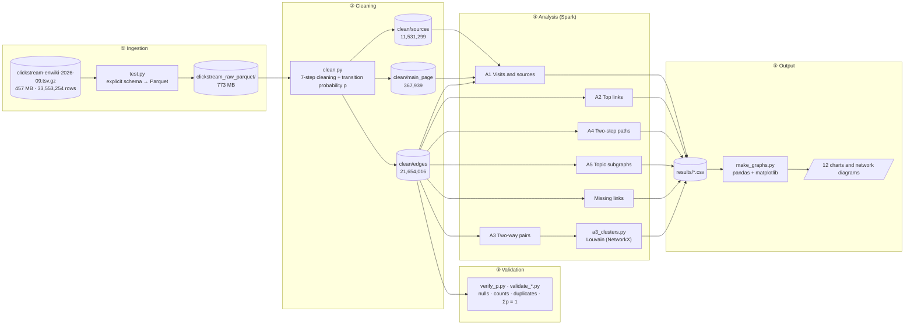

# WikiFlow: Large-Scale Analysis of Wikipedia Clickstream Data Using Apache Spark

> A PySpark pipeline that turns **33.5 million** raw Wikipedia navigation records into a clean, validated navigation graph of **21.65 million** edges, then analyses it to show how readers find and move between articles.


---

## Highlights

| 33.5M | 21.65M | 69.5% | 651 | 0 |
|:---:|:---:|:---:|:---:|:---:|
| raw records processed | clean article-to-article edges | of arrivals come from search engines | Louvain communities found | nulls, duplicates or bad probability sums |

- **Search drives arrivals:** most readers land on Wikipedia from a search engine, not from links between articles.
- **Current events drive reading:** the 2026 Asian Games appear in the top articles, busiest link, strongest pair, top path and third-largest community.
- **Readers follow a few strong links:** on each page, a small number of links carry most of the outgoing traffic.

## Quick start

On a fresh checkout, the project generates a small synthetic sample dataset if the full Wikimedia dump is not present, so the scripts can be demonstrated without downloading the full dataset.

```bash
python3 bootstrap_sample_data.py
python3 clean.py
python3 demo.py
python3 graph_summary.py
```

The demo writes A1-A5 CSV results to `demo/results/`, including two-way pairs and communities (A3), estimated paths (A4), and four topic subgraphs (A5). The sample Parquet data is generated locally and is not committed. To process the real clickstream data instead, place `clickstream-enwiki-2026-09.tsv.gz` at the project root and run `python3 test.py` followed by `python3 clean.py`.

---

## System Architecture



Each stage is a separate script that reads the previous stage's output from disk, so any stage can be re-run without repeating the expensive earlier steps.

---

## Dataset

**Source:** [Wikimedia Clickstream](https://dumps.wikimedia.org/other/clickstream/), English Wikipedia, September 2026 release.
**File:** `clickstream-enwiki-2026-09.tsv.gz` (≈457 MB compressed, 33,553,254 rows)

| Column | Type | Meaning |
|---|---|---|
| `prev` | STRING | Previous article, or a source category such as `other-search` |
| `curr` | STRING | Destination article |
| `type` | STRING | `link` (A links to B), `other` (both articles, no direct link), `external` (arrived from outside) |
| `n` | LONG | Number of times readers made that transition in the month |

| Source category | Meaning |
|---|---|
| `other-search` | Arrived from an external search engine |
| `other-empty` | No referrer (typed URL or bookmark) |
| `other-internal` | Arrived from another Wikimedia project |
| `other-external` | Arrived from any other website |
| `other-other` | Referrer could not be classified |

> **Privacy:** Wikimedia publishes only pairs seen more than 10 times in the month. The data contains monthly totals only, with no individual readers or sessions.

### Sample input (format)

```text
prev                curr                            type      n
other-search        2026_Asian_Games                external  ...
2026_Asian_Games    2026_Asian_Games_medal_table    link      585024
Gloria_Steinem      David_Bale                      link      ...
```

---

## Technology Stack

| Component | Version / Details |
|---|---|
| Environment | Ubuntu on WSL2 |
| Language | Python 3.14.4 |
| Java runtime | OpenJDK 17.0.20.1 |
| Processing engine | Apache Spark (PySpark) 4.2.0, local mode |
| Storage | Apache Parquet |
| Graph analysis | NetworkX (Louvain community detection) |
| Charts | pandas, matplotlib |
| Version control | Git and GitHub |

### Spark configuration

| Script | Master | Key settings |
|---|---|---|
| `clean.py` | `local[1]` | 8 shuffle partitions, AQE on, 16 MB max input partition, vectorised reader off |
| `verify_p.py` | `local[1]` | Vectorised Parquet reader off |
| `a1`–`a5`, `missing_links.py` | `local[2]` | 4 GB driver memory, 16 shuffle partitions, parallelism 4 |
| `graph_summary.py` | `local[*]` | All available cores |

### Why Spark and Parquet?

- **Spark, not pandas:** 33.5M rows do not fit comfortably in a single Python process's memory. Spark splits the data into partitions and processes them in parallel, and the same code would run unchanged on a cluster.
- **Explicit schema:** skips the type-inference pass over the data and guarantees `n` is read as a 64-bit `LONG`.
- **Parquet:** a gzip file cannot be split, so it is read by a single task. Converting it once to columnar Parquet lets every later job read in parallel, load only the columns it needs, and skip blocks using statistics. The output is larger (773 MB vs 457 MB) because the input was already compressed; the trade-off favours read speed over size.
- **`groupBy` + `join` for `p`, not a window:** avoids pulling all of one page's rows into a single task.

---

## Pipeline

### 1. Ingestion: `test.py`

```python
df = spark.read.csv("clickstream-enwiki-2026-09.tsv.gz", sep="\t",
                    schema="prev STRING, curr STRING, type STRING, n LONG")
df.write.mode("overwrite").parquet("clickstream_raw_parquet")
```

### 2. Cleaning: `clean.py`

| # | Step | Records after |
|---|---|---:|
| – | Raw dataset | 33,553,254 |
| 1 | Drop nulls and `n ≤ 0` (removed nothing) | 33,553,254 |
| 2 | Move `prev = other-*` rows to **`sources`** | 11,531,299 → sources |
| 3 | Keep only `link` and `other` types | |
| 4 | Remove self-links (`prev = curr`) | 22,021,955 |
| 5 | Move `Main_Page` rows to **`main_page`** | 367,939 → main_page |
| 6 | Add `title_clean` (underscores → spaces) | |
| 7 | Compute transition probability `p` → **`edges`** | **21,654,016** |

**Transition probability**, the share of A's outgoing clicks that go to B:

```
p(A → B) = n(A → B) / Σ n(A → all)
```

Main_Page is kept separate because its huge landing traffic would distort the probabilities.

### 3. Validation: `verify_p.py`, `validate_*.py`

| Check | Result |
|---|---|
| Nulls in `prev` / `curr` / `type` / `n` | ✅ none |
| Negative or zero counts | ✅ none |
| Probability sums per source page | ✅ 2,112,678 pages, **0** outside ±0.001 |
| Duplicate `(prev, curr, type)` groups | ✅ 0 |
| Internal `link` rows | 21,241,212 |
| Unique source pages (`link`) | 2,104,547 |
| Unique destination pages (`link`) | 3,126,020 |

> The probability check counts 2,112,678 sources (`link` + `other` rows); the graph metrics count `link` rows only.

### 4. Analysis

| ID | Question | Spark method | Output |
|---|---|---|---|
| **A1** | Most-visited articles; where readers come from | Union all datasets, `groupBy(curr).sum(n)`; sum `sources` by `prev` | `a1_top_articles.csv`, `traffic_sources.csv` |
| **A2** | Busiest and most predictable links | Filter `type = link`; order by `n`, and by `p` with `n ≥ 1,000` | `a2_top_by_count.csv`, `a2_top_by_prob.csv` |
| **A3** | Pairs read in both directions, and their communities | Self-join with reversed edges, keep top 2,000; Louvain (seed 42) | `a3_two_way.csv`, `a3_clusters.csv` |
| **A4** | Most common two-step reading paths | Self-join on middle article B + B's outgoing total | `a4_paths.csv` |
| **A5** | Navigation around four chosen topics | Filter edges where `prev` or `curr` = article | `a5_subgraph_*.csv` |
| **ML** | Links readers want but that don't exist | Filter `type = other`; sum and rank by `n`, top 50 | `missing_links.csv` |

**A4 estimate** (assumes the next click depends only on the current page, the first-order Markov assumption):

```
readers(A → B → C) = n(A → B) × n(B → C) / out(B)
```

### 5. Visualisation: `make_graphs.py`

Turns the result CSVs into 12 charts: ranked bar charts, a log-scale community-size histogram, and network diagrams of communities and topic subgraphs.

---

## Results

### A1: Where readers come from

Total source clicks: **3,652,620,427**

| Source | Clicks | Share |
|---|---:|---:|
| Search | 2,539,581,604 | **69.53%** |
| Empty | 951,140,936 | 26.04% |
| Internal | 107,919,554 | 2.95% |
| External | 35,793,454 | 0.98% |
| Other | 18,184,879 | 0.50% |

**Most visited:** Main_Page (200.6M clicks, excluded from charts for scale), then Lizzie Borden (8.5M), Hyphen-minus (7.8M) and Killing of the Clancy children (7.3M). Pages such as Hyphen-minus, `.xxx` and `.xyz` likely reflect automated traffic.

### A2: Top transitions

- **Busiest link:** 2026 Asian Games → 2026 Asian Games medal table, **585,024** clicks (p ≈ 0.237).
- **12 links have p = 1.0**, mostly short or ambiguous titles that pass readers on (e.g. Nes → NES, DHH → David Heinemeier Hansson).

### A3: Navigation communities

- Strongest two-way pair: 2026 Asian Games ↔ medal table, **611,906** combined clicks.
- **651 communities** covering **2,538 articles**; 405 are just pairs.
- Largest: **C01** September 11 attacks (64), **C02** 2026 films (58), **C03** 2026 Asian Games (44).

### A4: Two-step reading paths

| Step 1 | Step 2 | Step 3 | Est. readers |
|---|---|---|---:|
| 2026 Asian Games | 2026 Asian Games medal table | India at the 2026 Asian Games | 245,857 |
| Gloria Steinem | David Bale | Christian Bale | 168,429 |
| Monster: The Lizzie Borden Story | Ella Beatty | Annette Bening | 153,442 |
| Monster: The Lizzie Borden Story | Ella Beatty | Warren Beatty | 151,328 |
| Ella Beatty | Annette Bening | Warren Beatty | 145,025 |

Many top paths follow family and relationship links.

### A5: Topic subgraphs

| Article | Incoming | Outgoing | Total | Top next click |
|---|---:|---:|---:|---|
| 2026 Asian Games | 422 | 437 | 859 | 2026 Asian Games medal table |
| Artificial intelligence | 725 | 522 | 1,247 | History of artificial intelligence |
| India | **1,762** | 754 | 2,516 | Narendra Modi |
| Python (programming language) | 181 | 182 | 363 | Guido van Rossum |

The diagrams show the top 15 incoming links in blue and the top 15 outgoing links in orange; line width shows clicks.

### Candidate missing links

`type = other` means readers went A → B although A has no link to B. High counts suggest a link readers want.

- **Top:** uBlock Origin → Google Search (131,227). Likely browser or extension behaviour, not reader intent.
- **Clear gaps:** Next elections in Germany → individual 2026 state elections (~37,500 each); 2026 US Open → previous year's singles events.

These are **candidates for editors to review**, not confirmed missing links.

---

## Project Structure

```text
wikiflow/
├── README.md
├── .gitignore
├── test.py                 # ① TSV.gz → raw Parquet
├── clean.py                # ② cleaning + transition probabilities
├── verify_p.py             # ③ probability check
├── validate_*.py           # ③ null / count / duplicate checks
├── graph_summary.py        #    graph metrics
├── a1_analysis.py          # ④ visits & traffic sources
├── a2_analysis.py          # ④ top transitions
├── a3_analysis.py          # ④ two-way pairs
├── a3_clusters.py          # ④ Louvain communities (NetworkX)
├── a4_analysis.py          # ④ two-step paths
├── a5_analysis.py          # ④ topic subgraphs
├── missing_links.py        # ④ candidate missing links
├── make_graphs.py          # ⑤ charts
├── results/                # curated result CSVs (tracked)
└── cleaning_log.txt
```

The input file and the generated Parquet datasets are **not** tracked in Git because of their size. Download the input from Wikimedia, and the scripts will regenerate everything else.

---

## Running the Project

**Prerequisites:** Python 3.x, Java 17, and about 4 GB of free RAM for the Spark driver.

```bash
# 1. Set up the environment
python -m venv ~/bda && source ~/bda/bin/activate
pip install pyspark==4.2.0 networkx pandas matplotlib

# 2. Place clickstream-enwiki-2026-09.tsv.gz in the project directory

# 3. Ingest, clean and validate (in order)
python test.py
python clean.py
python verify_p.py

# 4. Run the analyses (any order once clean/ exists; a3_clusters.py after a3_analysis.py)
python a1_analysis.py
python a2_analysis.py
python a3_analysis.py && python a3_clusters.py
python a4_analysis.py
python a5_analysis.py
python missing_links.py

# 5. Generate charts
python make_graphs.py
```

---

## Limitations

- The data holds **monthly aggregates only**, with no real sessions, so A4 paths are Markov **estimates**, not observed journeys.
- Communities come from the **2,000 strongest two-way pairs**, not the full graph.
- `type = other` transitions are **candidates**, not confirmed missing links.
- Some top pages are likely driven by **bot or automated traffic**.
- **Local mode, one laptop, one month of data**; cluster performance was not measured.

## Future Work

- Process **several months** to track how interest rises and falls.
- Run on a **multi-node Spark cluster** and measure speed-up.
- Compute **PageRank** and other centrality measures with Spark GraphFrames.
- Run **distributed community detection** on the full graph.
- **Filter bot traffic.**
- Build an **interactive dashboard** for exploring any article.
- **Rank missing-link candidates** so editors can act on them.

---

## References

- Wikimedia Foundation, *Wikipedia Clickstream*: https://dumps.wikimedia.org/other/clickstream/
- Zaharia et al., "Apache Spark: A Unified Engine for Big Data Processing," *Communications of the ACM*, 2016.
- Blondel et al., "Fast unfolding of communities in large networks," *J. Stat. Mech.*, 2008.
- West & Leskovec, "Human Wayfinding in Information Networks," *WWW*, 2012.
- Paranjape et al., "Improving Website Hyperlink Structure Using Server Logs," *WSDM*, 2016.
- Dimitrov et al., "What Makes a Link Successful on Wikipedia?," *WWW*, 2017.
